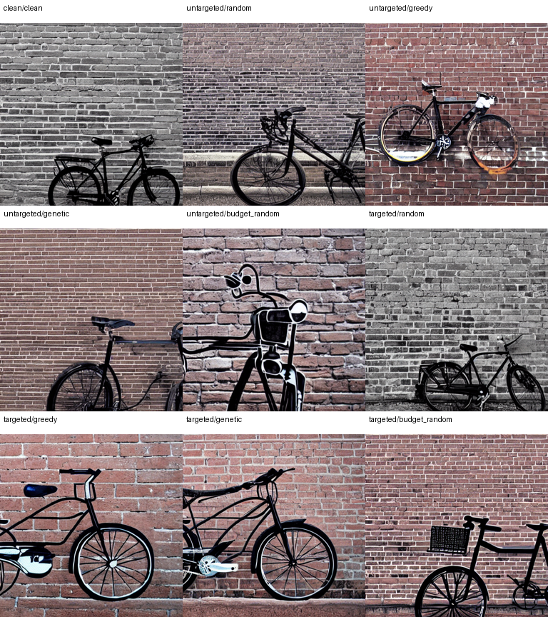
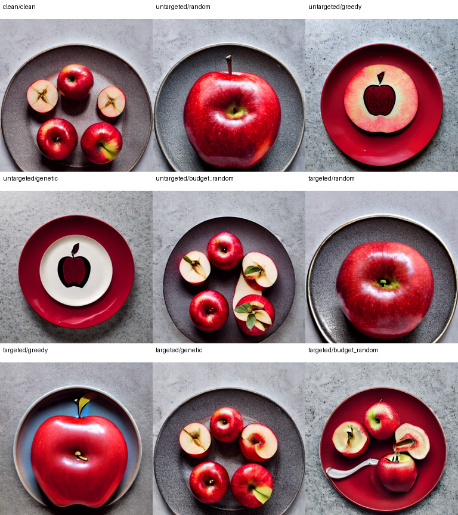

# Query-free adversarial attacks: paper analysis and notebook evidence

Prepared 4 November 2026. Notebook executed locally; ready for Google Colab upload.

Source: Haomin Zhuang, Yihua Zhang and Sijia Liu. A Pilot Study of Query-Free Adversarial Attack against Stable Diffusion, CVPR Workshop 2023, arXiv:2303.16378v2. The supplied eight-page PDF is the primary source. Prepared 4 November 2026.


## 1. What the paper establishes

The study attacks a text-to-image system through its text conditioning interface. It appends a short, visible character string to an otherwise unchanged prompt, searching for text embeddings that differ from the original. Its main contribution is evidence that encoder-level perturbations can transfer into substantial changes in Stable Diffusion output without running diffusion during attack construction.

Threat model. The attacker can evaluate a locally accessible CLIP text encoder and modify the prompt. The victim is Stable Diffusion v1.4. Query-free refers specifically to the diffusion pipeline during search; encoder evaluations and post-search image generation still incur computation. This is a text-side attack on a multimodal system, not a joint text-and-image-input perturbation or a demonstration of safety-filter bypass.

Targeted setting. A mask selects embedding coordinates whose changes are consistent when a target phrase is added across contexts. Minimizing cosine only on these coordinates aims to suppress target-related image content. The loss does not explicitly preserve other objects and does not impose a signed direction toward a target-free representation.

| Method | Untargeted image cosine | Target-concept image cosine |
|---|---|---|
| No attack | 0.277 +/- 0.022 | 0.229 +/- 0.030 |
| Random | 0.271 +/- 0.021 | 0.223 +/- 0.037 |
| Greedy | 0.255 +/- 0.039 | 0.204 +/- 0.037 |
| Genetic | 0.203 +/- 0.042 | 0.186 +/- 0.040 |
| PGD | 0.226 +/- 0.041 | 0.189 +/- 0.041 |

These are the paper's measurements, not this notebook's results. Each method is reported over 20 prompts with 10 images per prompt. Genetic search reduces the reported means by 0.074 (26.7%) for untargeted alignment and 0.043 (18.8%) for target-concept alignment. Those percentages describe relative score reductions, not attack success rates.


## 2. How the notebook implements the attack

Let h(x) flatten the CLIP final hidden states to 59,136 values (77 tokens x 768 dimensions). The full sequence includes EOS padding, following the authors' reference implementation. This representation differs from CLIP's projected pooled text vector used for image scoring.

For each context pair, d_i = h(context_i + ' and ' + target) - h(context_i). The mask is I_j = 1 when abs(sum_i sign(d_ij)) &gt; 0.9n. With n = 10 and a strict inequality, all ten nonzero signs must agree. An empty mask raises an error. The 62-character alphabet matches the reference set after removing its duplicated '*'; a five-character suffix has 62^5 = 916,132,832 possibilities.

| Component | Implementation and scope |
|---|---|
| Genetic | 10 generations, 20 candidates, mutation probability 0.3. Two elites, 3-way tournament, one-point crossover, one-character mutation. |
| Greedy | One coordinate sweep across all characters at each of five suffix positions, starting from a random five-character suffix. |
| Controls | One random suffix; plus uniform random search matched to the genetic method's unique candidate evaluations separately per prompt and objective. |
| Target mask | Ten fixed paired contexts supplied in code; no language-model API required. Concept phrase includes the article, e.g. 'a plate'. |
| PGD | Reported in the paper but not implemented in this deliverable. No completeness or exact Table 1 replication claim. |

Measured run. Two prompts: 'A black bicycle against a brick wall' (remove bicycle, retain wall) and 'A red apple on a plate' (remove plate, retain apple). Search seed: 2026. Encoder device: mps. The notebook was executed locally through its actual cells; hosted Google Colab execution was not performed.

Image protocol. 1 paired seed per scene (27); 20 inference steps, guidance 7.5, 512 x 512 images. The saved scheduler is the checkpoint's PNDM configuration. The demo's 20 steps and one image seed are reductions for local validation; the extended profile uses 50 steps and ten seeds. Initial noise is drawn once on CPU and cloned for every condition; matching hashes are verified. The default safety checker remains enabled.

The extended profile provides 20 declared scenes and 50 GA generations; 12 scene prompts are new additions. It is not the authors' exact dataset. Different mask contexts, operators, sampling details and model-weight precision can change outcomes.


## 3. Measured encoder results

Lower objective cosine means a larger change in the selected text representation. Untargeted and targeted rows use different coordinate sets and should not be compared as if they were the same scale. The clean self-cosine is 1.0000.

| Case | Objective | Method | Suffix | Cosine | Candidates |
|---|---|---|---|---|---|
| 0 | Full | Random (1) | ^FF1% | 0.8628 | 1 |
| 0 | Full | Greedy | FC·!U | 0.6722 | 306 |
| 0 | Full | Genetic | &#124;ZPV> | 0.6935 | 106 |
| 0 | Full | Random (budget) | E2&#124;,D | 0.6901 | 106 |
| 0 | Masked | Random (1) | .7P<Y | 0.8510 | 1 |
| 0 | Masked | Greedy | DJE$8 | 0.6010 | 306 |
| 0 | Masked | Genetic | 61PV' | 0.7411 | 105 |
| 0 | Masked | Random (budget) | QMT$9 | 0.7087 | 105 |
| 1 | Full | Random (1) | H3X4\ | 0.8254 | 1 |
| 1 | Full | Greedy | .Y1$) | 0.7231 | 306 |
| 1 | Full | Genetic | CT7#S | 0.6591 | 103 |
| 1 | Full | Random (budget) | +&#124;SOX | 0.7022 | 103 |
| 1 | Masked | Random (1) | #5)CT | 0.7577 | 1 |
| 1 | Masked | Greedy | GP38I | 0.5953 | 306 |
| 1 | Masked | Genetic | Y!KD8 | 0.7107 | 94 |
| 1 | Masked | Random (budget) | X27QH | 0.7457 | 94 |

Case 0 = bicycle/wall; case 1 = apple/plate. The separating space is outside the five-character suffix budget. Candidate counts exclude mask construction, clean-reference encoding and post-search diagnostics.

Finding: Genetic search beats budget-matched random search for the apple scene on both objectives, while the matched random control beats genetic search for the bicycle scene on both objectives. Greedy search has the lowest targeted objective on both scenes, but it evaluates 306 unique candidates per run, more than the 94-106 used by this short GA. This two-scene test does not establish a general ranking of optimizers.

The selected mask contains 23,310/59,136 coordinates (39.4%) for a black bicycle; 19,373/59,136 coordinates (32.8%) for a plate. The mask is not especially sparse in this run. Sign consistency measures agreement, not effect magnitude or a causal role in object rendering.

The saved search manifest records 2,117 text encodings in 336 forward batches and zero diffusion calls. Search-loop duration was 21.2 seconds, excluding initial model load and downloads; this is a local timing observation, not a hardware-independent speed claim.


## 4. Measured image results

The image stage generated and scored 18 images: two prompts x 1 seed x nine conditions. Filtered images: 0. All results below use raw CLIP cosine. Positive drop means clean minus attacked; negative drop means alignment increased. Values average paired differences across prompts and seeds.

| Scored content | Method | Pairs | Mean drop | Retained drop |
|---|---|---|---|---|
| Full prompt | Random (1) | 2 | +0.0029 | +0.0102 |
| Full prompt | Greedy | 2 | -0.0224 | -0.0073 |
| Full prompt | Genetic | 2 | -0.0277 | +0.0084 |
| Full prompt | Random (budget) | 2 | +0.0296 | +0.0198 |
| Target concept | Random (1) | 2 | -0.0122 | -0.0064 |
| Target concept | Greedy | 2 | -0.0033 | +0.0118 |
| Target concept | Genetic | 2 | +0.0120 | +0.0516 |
| Target concept | Random (budget) | 2 | -0.0144 | -0.0073 |

The retained-concept score is a diagnostic: a large positive drop suggests collateral semantic change. It does not impose a guarantee of preservation. No confidence intervals or success rate are claimed from only two independent scenes.

Original-prompt alignment. Largest measured drop: Random (budget), +0.0296. Genetic: -0.0277; matched random: +0.0296. This comparison is descriptive, with only two scenes and one search initialization per case and method.

Target-concept alignment. Largest measured drop: Genetic, +0.0120. Genetic: +0.0120; matched random: -0.0144. This comparison is descriptive, with only two scenes and one search initialization per case and method.

Why text loss is insufficient. The encoder objective and image alignment operate on different representations. In the inspected case-0 targeted greedy image, the bicycle and wall remain recognizable despite masked text cosine falling to 0.6010. A strong text-space perturbation can leave an object visible, replace it with a related object, or alter style and composition. Conversely, a smaller text-space shift may change the generated scene. The grids on the next pages expose these differences rather than treating every lower score as successful object removal.

Evaluation limit. The attack and evaluator share the CLIP model family. A score drop can partly reflect encoder sensitivity rather than independent evidence of semantic failure. Blinded human labels or an independent object detector would be needed to quantify target removal with retained-content preservation.


## 5.1. Paired visual evidence: case 0

Clean prompt: A black bicycle against a brick wallTarget to remove: a black bicycle; content to retain: a brick wall. Seed 27.

Reading order: clean; untargeted random, greedy, genetic and matched random; then targeted random, greedy, genetic and matched random. All nine images use the same initial noise. Full-resolution images are included in the results bundle. No manual target-presence labels are claimed.




## 5.2. Paired visual evidence: case 1

Clean prompt: A red apple on a plateTarget to remove: a plate; content to retain: a red apple. Seed 27.

Reading order: clean; untargeted random, greedy, genetic and matched random; then targeted random, greedy, genetic and matched random. All nine images use the same initial noise. Full-resolution images are included in the results bundle. No manual target-presence labels are claimed.

Qualitative observation: the untargeted genetic image changes the real fruit seen in the clean output into an apple motif on tableware. This is a change in rendered content, while recognizable apple and plate concepts can remain.




## 6. Optimizing the attack: features and objective

Status: proposed follow-up experiments. These changes have not been implemented or tested in the delivered attack code. The aim is greater image-level effectiveness under the same five-character suffix constraint. In this attack, text is the editable input and the generated image is the outcome to evaluate; there is no input image whose pixels are optimized.

First priority: optimize the intended outcome. Our targeted genetic run reduced mean target alignment by 0.0120, but retained-content alignment fell by 0.0516. The bicycle also remained visible in the targeted greedy example despite a masked text cosine of 0.6010. These observations motivate improving the loss before simply increasing the search budget. They do not establish which proposed replacement will work best.

| Important part | What to examine and why |
|---|---|
| Target noun and attributes | Separate 'bicycle' from 'black', or 'plate' from 'red apple'. Distinguish object removal from a color or style change. Use controlled phrase-removal or replacement probes to estimate sensitivity. |
| Retained nouns and relations | Protect 'brick wall' and 'red apple'. Inspect relations such as 'against' and 'on': changing a relation may alter layout while leaving both objects present. These probes diagnose importance; they do not edit the base prompt in the suffix-only attack. |
| Suffix tokens and boundaries | Measure the actual CLIP tokenization of each complete prompt. Five characters can become a different number of BPE tokens. Track suffix token IDs, boundary effects and truncation; keep the suffix at the end for a comparable threat model. |
| Embedding coordinates | Compare the original padded 77-token representation with EOS pooling or explicitly aligned content-token features. Recompute concept masks for each representation. A large padding-state shift need not imply an object change. |
| Target and retained image regions | Inspect bicycle frame/wheels versus wall texture and geometry; plate rim/surface versus apple shape, color and count. Include background and object placement, not just the target crop. These are evaluation cues, not established causal rankings. |

A proposed directional, multi-objective loss. Let z(x) be a normalized text representation and let x_minus be a grammatical caption describing the desired remaining scene: for example, 'A red apple' when removing the plate. It is a loss reference, not the actual prompt sent to diffusion. For x_adv = x + space + suffix, consider:

```text
L = ||z(x_adv) - z(x_minus)||^2 + lambda * ||P_keep (z(x_adv) - z(x))||^2
```

P_keep is a candidate projector onto retained-concept directions, estimated from separate paired text examples in the same representation space. Lambda controls the preservation penalty. This is a hypothesis: target and retained semantics can overlap, and a caption without the target does not guarantee its absence in an image. Compare the original loss, the directional term alone and the combined loss on held-out prompts.


## 6.1. Search, image feedback and validation

| Optimization type | Proposed change and comparison |
|---|---|
| Discrete search | Test GA diversity/restarts, mutation schedules, coordinate refinement and beam search. Compare all methods against uniform random search at the same unique-candidate budget. More generations alone do not demonstrate a better optimizer. |
| Feature and mask selection | Use more varied context pairs, test sign stability together with change magnitude, and validate masks on unseen contexts. Ablate target noun, attributes and relations separately before assigning importance. |
| Gradient-assisted proposals | A continuous relaxation could propose token edits, followed by projection to legal character strings and rescoring through the real tokenizer. Discrete tokenization is not directly differentiable. Five-token solutions need not satisfy a five-character limit. |
| Robust optimization | Test whether a suffix works across held-out contexts or compatible encoder surrogates. Repeated search initializations assess search stability; repeated image seeds assess downstream reliability. Report these separately. |
| Compute efficiency | Batch encoder evaluations and cache duplicates. Record unique candidates, forward batches and elapsed time. Speed improvements are distinct from improvements in attack success. |

Gradient-based hard-prompt search is an established research direction (Wen et al., Hard Prompts Made Easy, 2023; reference below). Adapting it to this character constraint would be a new implementation and evaluation, not a result of the current notebook.

Where image information belongs. For a strictly query-free search, generated images are used only after a suffix is fixed. Evaluate target presence with an independent detector or blinded human review, and inspect retained objects and background separately. An object mask can identify the target region; compare outside an expanded target region to allow necessary changes to shadows and occlusions. Region similarity is a preservation proxy, not proof.

If image feedback selects suffixes, loss weights or restarts, explicitly call that a query-assisted extension and count all diffusion calls. A possible objective minimizes target presence plus a weighted penalty for changes to retained objects and background. The weights can be tuned on development prompts, or candidates can be compared on a Pareto frontier showing the trade-off between removal and preservation. Attention maps may help diagnose associations, but they are not causal evidence or an object-presence test.

A practical experiment order. First compare the three text losses at a fixed budget (for example, 1,000 unique candidates per prompt and method). Next ablate representation and mask construction, then compare search strategies and restarts within that same budget. Freeze choices on a development set before evaluating new prompts and seeds. If development tuning uses generated images, report those queries even when final suffix generation uses text only.

For targeted success, first verify that the clean image contains the target; then require its removal together with preservation of the intended remaining scene. Report baseline failures and the eligible denominator separately. Define any detector thresholds and preservation tolerances before testing. Keep resolution, denoising steps and guidance fixed across methods. Scale beyond the two-scene demo to more prompts, several search initializations and multiple paired image seeds; report prompt-level uncertainty, costs and failure cases. These tests establish whether an optimization improves the image outcome rather than only the encoder surrogate.


## 7. Assessment and reproducibility

Strengths of the paper. A clear modular vulnerability, a simple diffusion-free search loss, character-level constraints, multiple search approaches and paired-seed visual examples. The WALL-E case study checks a plausible alternative explanation for one suffix.

What remains unproven. The 20-prompt benchmark is small. CLIP cosine is not an object presence label, and the targeted objective includes no preservation term. Sign-vote masks depend on chosen contexts, token alignment and padding, and are coordinate-basis dependent. The experiments do not establish transfer to newer diffusion architectures or multilingual prompts. Selection over trials and optimizer budgets require explicit accounting for a fair comparison.

Conclusion from this implementation. The code confirms that short suffixes can substantially reduce the specified CLIP text-space objectives without querying diffusion. The paired image measurements provide additional, limited evidence of changes in text-image alignment; they do not demonstrate reliable selective removal. The measured comparison with budget-matched random search is mixed, so the paper's optimizer ranking is not established by this smaller run. This is a method reproduction, not an exact replication.

Specifically, untargeted genetic search has a mean original-prompt score drop of -0.0277 (alignment increased). Targeted genetic search reduces target alignment by 0.0120, while retained-content alignment falls by 0.0516. These results do not demonstrate reliable selective removal. The short search and reduced image sampling settings limit comparison with the paper.

1. Upload QF_Attack_Colab.ipynb at colab.research.google.com.2. Select T4 GPU and Runtime Version 2026.07 (Python 3.12); execute cells in order.3. Keep RUN_IMAGES=True for the complete evaluation. Select 'extended' only for a larger run.4. Download the automatically generated results ZIP and run_report.md. Expect fresh suffixes or scores if the device, software or configuration differs.

Deliverables: standalone Colab notebook; locally executed notebook; qf_attack.py; requirements-colab.txt; qf_results_bundle.zip; CSV metrics; masks; search traces; paired grids; manifest and scheduler configuration. tools/validate_results.py checks mask threshold behavior, budgets, suffix constraints, objective consistency, convergence, latent pairing, paired score arithmetic and notebook execution status.

Observed software: Python 3.12.14; torch 2.6.0; transformers 4.49.0; diffusers 0.32.2; accelerate 1.4.0; huggingface-hub 0.28.1; numpy 2.3.5. Colab dependencies are pinned separately; differences are recorded, not hidden.

SD commit: 133a221b8aa7292a167afc5127cb63fb5005638bCLIP commit: 32bd64288804d66eefd0ccbe215aa642df71cc41Image weights: fp16 checkpoint variant; torch.float16 inference on mps.

[Paper, arXiv:2303.16378v2 (supplied PDF, especially pp. 3-6)](https://arxiv.org/abs/2303.16378v2)

[Authors' QF-Attack code and original notebook](https://github.com/OPTML-Group/QF-Attack)

[Stable Diffusion v1.4 checkpoint and model card](https://huggingface.co/CompVis/stable-diffusion-v1-4)

[CLIP ViT-L/14 checkpoint and model card](https://huggingface.co/openai/clip-vit-large-patch14)

[Google Colab runtime versions and Python 3.12 runtime selection](https://research.google.com/colaboratory/runtime-version-faq.html)

[Wen et al., Hard Prompts Made Easy (gradient-based hard-prompt optimization)](https://arxiv.org/abs/2302.03668)

