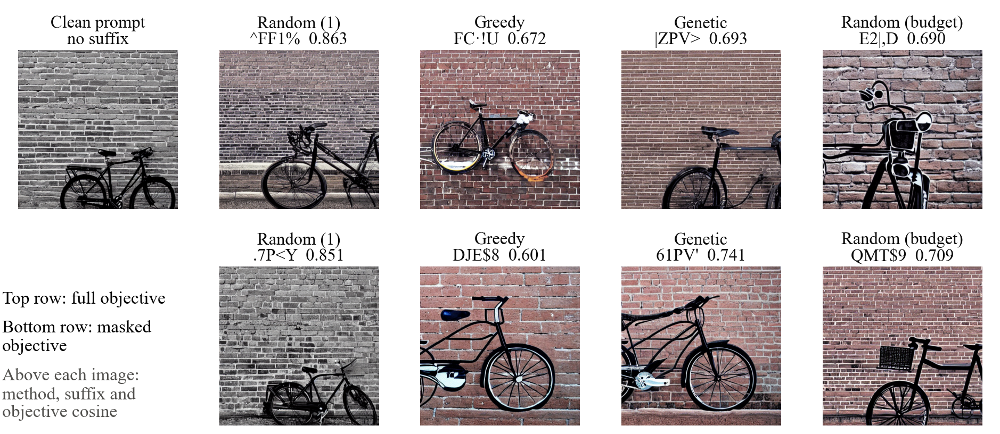
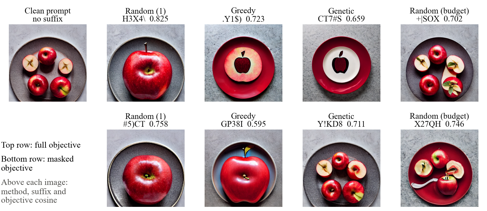
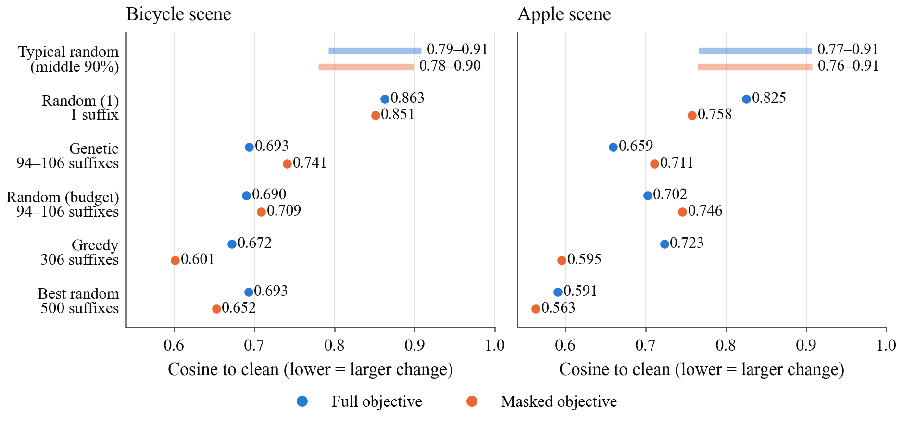
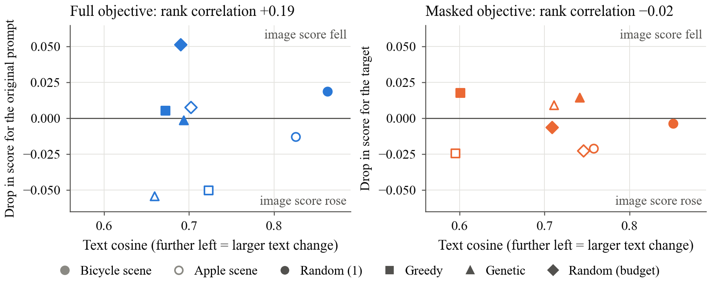
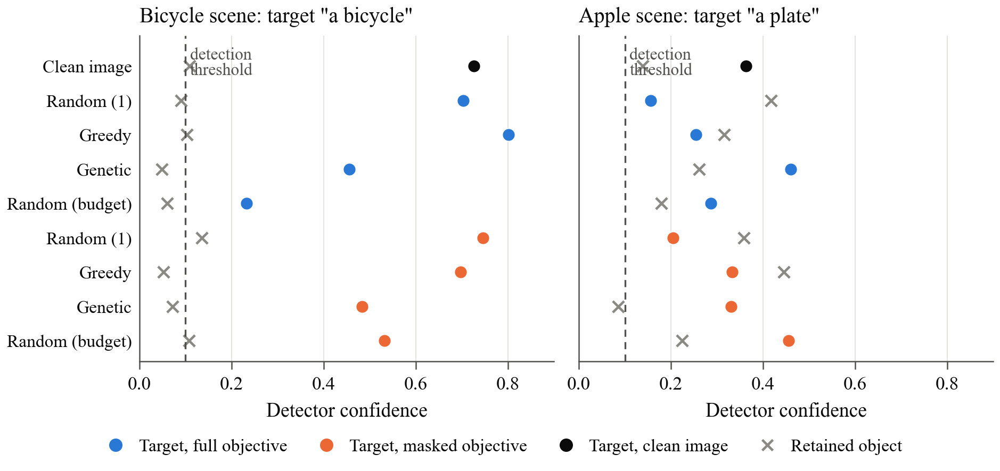

# Query-Free Adversarial Attacks on Stable Diffusion: A Small-Scale Reproduction

S M Raihanul Alam | Department of Computer Science, University of Iowa | November 2026

## Abstract

Zhuang et al. [1] showed that appending five characters to a prompt can change the output of Stable Diffusion, using a search that only evaluates the CLIP text encoder and never calls the diffusion model. This report reimplements their untargeted and targeted objectives with genetic, greedy and gradient-based (PGD) search and adds a random-search control matched to the genetic budget. On two prompts from the paper, all searches lowered the text-embedding objective well below a single random suffix, with cosine values of 0.59 to 0.75 against 0.76 to 0.86. The effect on images was much weaker. Mean CLIP score drops were at most 0.030, some were negative, and an independent object detector still found the target object in all eight targeted images. The genetic algorithm did not consistently beat matched random search. An analysis of the embeddings shows why the attack may not remove objects: the encoder output at the target word does not change at all, more than 99% of the mask falls on padding positions, and every suffix moves the embedding further from a target-free version of the prompt. With two prompts and one seed, these results describe this run only and do not test the paper's method ranking.

## 1. Introduction

Text-to-image models take their conditioning from a text encoder, so any weakness in that encoder may carry through to the generated image. Zhuang et al. [1] use this to attack Stable Diffusion v1.4 [2] with a short character suffix, chosen by querying only the CLIP text encoder [3]. Because the encoder is public and cheap to run, the attacker needs no access to the image model during the search.

The paper makes two claims that this report examines. The first is that a five-character suffix substantially changes the generated image. The second is that restricting the search to selected embedding dimensions can remove a chosen object while leaving the rest of the scene intact.

The contribution here is a reproduction of the method at reduced scale, with one addition to the evaluation: a random-search control that receives the same number of encoder evaluations as the genetic algorithm. This control shows how much of the genetic algorithm's result comes from its search strategy and how much comes from simply trying many suffixes.

## 2. Background

### 2.1 Threat model

The attacker can evaluate the CLIP text encoder and can append up to five characters to a prompt. "Query-free" applies to the diffusion pipeline during the search only, so encoder evaluations are still required. The attack does not perturb image inputs, and the paper does not study safety-filter bypass.

### 2.2 Attack objectives

Let τ(x) be the text embedding of prompt x, and x′ the prompt with a suffix appended. The untargeted attack minimizes cos(τ(x), τ(x′)).

The targeted attack applies the same loss to a subset of dimensions, cos(I · τ(x), I · τ(x′)), where I is a binary mask applied element-wise. To build the mask, n sentences are encoded with and without the target phrase, giving difference vectors d_i. Dimension j is selected when |Σ_i sign(d_i,j)| > εn. The paper uses n = 10 and ε = 0.9, so all ten signs must agree. Nothing in this loss explicitly preserves the rest of the scene.

### 2.3 Published results

Table 1 gives the paper's results for 20 prompts with 10 images each. Genetic search lowers the mean score by 0.074 (26.7%) in the untargeted setting and by 0.043 (18.8%) in the targeted setting.

Table 1. CLIP scores reported by Zhuang et al. [1, Table 1], as mean ± standard deviation.

| Method | Untargeted | Targeted |
|---|---|---|
| No attack | 0.277 ± 0.022 | 0.229 ± 0.030 |
| Random | 0.271 ± 0.021 | 0.223 ± 0.037 |
| Greedy | 0.255 ± 0.039 | 0.204 ± 0.037 |
| Genetic | 0.203 ± 0.042 | 0.186 ± 0.040 |
| PGD | 0.226 ± 0.041 | 0.189 ± 0.041 |

## 3. Method

### 3.1 Implementation

The embedding is the final hidden state of the CLIP ViT-L/14 text encoder, flattened to 59,136 values (77 tokens × 768 dimensions) with padding tokens included, as in the authors' code [4]. Suffixes are drawn from 62 characters, giving 62^5 = 916,132,832 possibilities. Five search methods were run for each prompt and objective:

- **Random (1):** a single random suffix.
- **Greedy:** one sweep over the five positions from a random start, keeping the best of the 62 characters at each position.
- **Genetic:** 10 generations of 20 candidates with mutation probability 0.3, two elites, 3-way tournament selection and one-point crossover.
- **Random (budget):** uniform random search over the same number of unique candidates as the genetic run for that prompt and objective.
- **PGD:** the gradient-based attack from the paper, following the authors' code [4]. Each of the five suffix slots holds a relaxed distribution over the 62 characters; Gumbel-softmax draws near-discrete samples, and a sign-gradient step on the relaxed logits maximises 1/cosine for 100 iterations. The final discrete suffix is scored with the same flattened-embedding cosine as the other methods, so its value is directly comparable. This ran on CPU in float32, as Gumbel-softmax and double precision are unsupported on the MPS device used for the other searches, and made no diffusion calls. It was added as a reproduction of the paper's baseline, not as a stronger attack.

PGD operates on the text embedding only; no images were generated for its suffixes, so it appears in the text-embedding results (Table 3) but not in the image-score or detector tables.

### 3.2 Scenes and image generation

Two prompts from the paper's targeted examples were used. The first is "A black bicycle against a brick wall", with the bicycle as target and the wall as retained content. The second is "A red apple on a plate", with the plate as target and the apple as retained content.

Images were generated at 512 × 512 with Stable Diffusion v1.4, using 20 PNDM steps and guidance scale 7.5. Each scene used one seed (27), and the same initial noise was reused for all nine conditions: the clean prompt plus four methods under each of two objectives. This gave 18 images, and the safety checker, which was left enabled, flagged none of them.

Table 2 lists where this run differs from the paper.

Table 2. Differences between the paper's setup and this run.

| Setting | Paper [1] | This run |
|---|---|---|
| Prompts | 20 | 2 |
| Images per prompt | 10 | 1 per condition |
| Genetic generations | 50 | 10 |
| Search methods | Random, greedy, genetic, PGD | Random, greedy, genetic, PGD, matched random |
| Mask sentences | Generated with ChatGPT | Ten fixed sentences defined in the code |

### 3.3 Evaluation

Images were scored with the raw cosine similarity between CLIP image and text embeddings, without the rescaling sometimes applied to CLIP scores. Three texts were scored for each image: the original prompt, "This is a photo of" plus the target, and the same template plus the retained content. Results are reported as the drop from the clean image with the same seed, so a positive value means alignment fell and a negative value means it rose. Confidence intervals are omitted because there are only two scenes.

### 3.4 Embedding analysis

The 16 recorded suffixes were encoded again with the same encoder and revision, which reproduced every recorded cosine to within 0.001. Four measurements were then taken for each suffix: the L2 distance from the clean embedding at each of the 77 token positions, the share of the total squared change that falls on padding positions, the cosine to a target-free prompt ("A brick wall" or "A red apple"), and the rank correlation between text cosine and image score drop.

To give a reference distribution, 500 further random suffixes were encoded for each scene. These were used only for this analysis and are not part of any search budget. All values in the embedding figures are measured cosines or distances, so no dimensionality reduction is involved.

## 4. Results

### 4.1 Text-embedding objective

Table 3 shows the search results. Lower cosine means a larger change in the embedding. The full and masked objectives use different sets of dimensions, so their values should not be compared directly.

Table 3. Best suffix and objective cosine for each scene, objective and method. Candidates is the number of unique suffixes evaluated; for PGD it is the number of gradient steps, each drawing 16 Gumbel-softmax samples.

| Scene | Objective | Method | Suffix | Cosine | Candidates |
|---|---|---|---|---|---|
| Bicycle | Full | Random (1) | `^FF1%` | 0.8628 | 1 |
| Bicycle | Full | Greedy | `FC·!U` | 0.6722 | 306 |
| Bicycle | Full | Genetic | `\|ZPV>` | 0.6935 | 106 |
| Bicycle | Full | Random (budget) | `E2\|,D` | 0.6901 | 106 |
| Bicycle | Full | PGD | `-E\|7K` | 0.5886 | 100 steps |
| Bicycle | Masked | Random (1) | `.7P<Y` | 0.8510 | 1 |
| Bicycle | Masked | Greedy | `DJE$8` | 0.6010 | 306 |
| Bicycle | Masked | Genetic | `61PV'` | 0.7411 | 105 |
| Bicycle | Masked | Random (budget) | `QMT$9` | 0.7087 | 105 |
| Bicycle | Masked | PGD | `$6·Q\|` | 0.6205 | 100 steps |
| Apple | Full | Random (1) | `H3X4\` | 0.8254 | 1 |
| Apple | Full | Greedy | `.Y1$)` | 0.7231 | 306 |
| Apple | Full | Genetic | `CT7#S` | 0.6591 | 103 |
| Apple | Full | Random (budget) | `+\|SOX` | 0.7022 | 103 |
| Apple | Full | PGD | `·G65C` | 0.6064 | 100 steps |
| Apple | Masked | Random (1) | `#5)CT` | 0.7577 | 1 |
| Apple | Masked | Greedy | `GP38I` | 0.5953 | 306 |
| Apple | Masked | Genetic | `Y!KD8` | 0.7107 | 94 |
| Apple | Masked | Random (budget) | `X27QH` | 0.7457 | 94 |
| Apple | Masked | PGD | `GXQ7\|` | 0.8303 | 100 steps |

Every search beat a single random suffix. Genetic search beat matched random search on both objectives for the apple scene, and lost on both for the bicycle scene. Greedy reached the lowest masked cosine on both scenes, but it evaluated about three times as many candidates as the genetic runs, so this is not a like-for-like comparison.

PGD reached the lowest full cosine of any method on both scenes (0.5886 for the bicycle and 0.6064 for the apple), consistent with a gradient attack on the full embedding being effective on the untargeted objective. On the masked objective it was mixed: for the bicycle it placed second behind greedy (0.6205 against 0.6010), but for the apple it did worst of all methods (0.8303, above even a single random suffix), one run where the relaxed optimisation did not converge on the masked subset. This matches the paper's finding that PGD is comparable to the discrete searches rather than uniformly stronger. Its cosines are not directly comparable to the paper's Table 1 numbers, which are image CLIP scores rather than text-embedding cosines.

The masks selected 23,310 of 59,136 dimensions (39.4%) for "a black bicycle" and 19,373 (32.8%) for "a plate". The whole search used 2,117 text encodings, made no diffusion calls and took 21.2 seconds on the Apple MPS device used for this run.

### 4.2 Image scores

Table 4 gives the mean drops. The untargeted rows are scored against the original prompt and the targeted rows against the target phrase.

Table 4. Mean paired drop in CLIP score over the two scenes. Retained drop is the same measure for the retained content.

| Objective | Method | Mean drop | Retained drop |
|---|---|---|---|
| Untargeted | Random (1) | +0.0029 | +0.0102 |
| Untargeted | Greedy | −0.0224 | −0.0073 |
| Untargeted | Genetic | −0.0277 | +0.0084 |
| Untargeted | Random (budget) | +0.0296 | +0.0198 |
| Targeted | Random (1) | −0.0122 | −0.0064 |
| Targeted | Greedy | −0.0033 | +0.0118 |
| Targeted | Genetic | +0.0120 | +0.0516 |
| Targeted | Random (budget) | −0.0144 | −0.0073 |

Untargeted genetic search raised alignment with the original prompt on average, and the largest untargeted drop came from matched random search. Targeted genetic search was the only targeted method with a positive target drop, but its retained content dropped by more. Most of that retained drop came from the bicycle scene, where the wall score fell by 0.1014 while the target score fell by only 0.0145. The lowest text cosine also did not produce the largest image effect: targeted greedy had the lowest masked cosine on both scenes, yet its mean target drop was slightly negative.

### 4.3 Visual inspection

Figures 1 and 2 show the generated images. The top row uses the full objective and the bottom row the masked objective, and all images in a figure share the same initial noise. These are informal, unblinded observations and no labels were collected.

The suffixes clearly change composition and style. Several bicycle images shift from a photograph towards an illustration, and in the apple scene the fruit changes in number and size. The untargeted genetic image replaces the real fruit with an apple motif on tableware. Removal did not occur, however. The bicycle remains visible in all four targeted bicycle images, and a plate remains visible in all four targeted apple images. Section 4.5 checks this with an object detector instead of by eye.

### 4.4 Embedding analysis

**Where the change happens.** Figure 3 follows the Greedy masked suffix through the encoder, one token at a time. Each position in CLIP's text encoder can only see earlier tokens, so a suffix cannot affect anything before it. The measurements confirm this: across all 16 suffixes, the largest change at any position before the suffix is 0.00004, against distances of about 12 to 37 from the suffix onwards. The tokens "bicycle" and "plate" therefore reach the diffusion model unchanged.

Most of the change falls on padding, which fills the remaining 63 to 66 of the 77 positions. Across the 16 suffixes, padding holds 72.2% to 92.7% of the squared change. It also holds about 87% of the squared norm of the clean embedding (86.8% and 87.9%), so the objective largely measures change in padding.

**What the mask selects.** The lower row of Figure 3 shows the same pattern in the mask. Of the 23,310 dimensions selected for "a black bicycle", 99.14% are on padding positions, and of the 19,373 selected for "a plate", 99.51% are. No dimension is selected at positions 0 to 6, because the vote must be unanimous and the embedding there does not change for every context sentence when the target phrase is added. The mask therefore contains nothing at the target word's own position in either prompt.

**Whether the attack moves towards a target-free prompt.** A suffix that removed the target might be expected to move the embedding closer to the same prompt without the target. Figure 4 plots both similarities directly, and Table 5 gives the targeted values. Every suffix moves the other way. On the bicycle scene, the clean prompt has cosine 0.6360 to "A brick wall", and the eight attacked prompts range from 0.3988 to 0.5414. On the apple scene, the clean prompt has cosine 0.7470 to "A red apple", and the attacked prompts range from 0.5168 to 0.6284. None of the 500 random suffixes came closer than the clean prompt either, so this drop comes from appending a suffix at all and is not specific to the searches.

Table 5. Targeted-attack examples with measured values. Cosine to target-free compares the full embedding with "A brick wall" or "A red apple". Padding share is the share of the squared change that falls on padding positions.

| Scene | Method | Suffix | Tokens | Masked cos. | Full cos. | Cos. to target-free | Padding share | Target drop | Retained drop |
|---|---|---|---|---|---|---|---|---|---|
| Bicycle | Clean | none | 0 | 1.0000 | 1.0000 | 0.6360 | n/a | n/a | n/a |
| Bicycle | Random (1) | `.7P<Y` | 5 | 0.8510 | 0.8608 | 0.5009 | 72.2% | −0.0036 | +0.0101 |
| Bicycle | Greedy | `DJE$8` | 4 | 0.6010 | 0.6616 | 0.3988 | 87.7% | +0.0177 | +0.0434 |
| Bicycle | Genetic | `61PV'` | 4 | 0.7411 | 0.7684 | 0.4805 | 85.8% | +0.0145 | +0.1014 |
| Bicycle | Random (budget) | `QMT$9` | 4 | 0.7087 | 0.7550 | 0.4479 | 87.1% | −0.0062 | +0.0190 |
| Apple | Clean | none | 0 | 1.0000 | 1.0000 | 0.7470 | n/a | n/a | n/a |
| Apple | Random (1) | `#5)CT` | 4 | 0.7577 | 0.7642 | 0.6218 | 87.9% | −0.0208 | −0.0229 |
| Apple | Greedy | `GP38I` | 4 | 0.5953 | 0.6095 | 0.5168 | 89.1% | −0.0243 | −0.0198 |
| Apple | Genetic | `Y!KD8` | 4 | 0.7107 | 0.7160 | 0.5421 | 87.4% | +0.0095 | +0.0019 |
| Apple | Random (budget) | `X27QH` | 5 | 0.7457 | 0.7395 | 0.5572 | 82.3% | −0.0226 | −0.0336 |

**How the searches compare with random suffixes.** Figure 5 compares each way of choosing a suffix. The mean full cosine for a random suffix is 0.8647 on the bicycle scene and 0.8493 on the apple scene, and the searches all reach well below the typical range. Random sampling also gets there when given more attempts, since the best of 500 suffixes is lower than every searched suffix on the apple scene. That sample is larger than any search budget (94 to 306).

**Whether text change predicts image change.** Figure 6 plots the text cosine against the image score drop for all 16 suffixes. If a larger text change produced a larger image effect, the points would slope down from upper left to lower right, giving a clearly negative rank correlation. The values are +0.19 for the full objective and −0.02 for the masked objective. With eight suffixes in each panel, this is only descriptive.

### 4.5 Independent object detection

The observations above and the CLIP scores both rely on CLIP, which is also the model under attack. As a separate check, the 18 images were scored with OWL-ViT, an open-vocabulary object detector [5], which was not used anywhere in the attack. For each image the detector reported its confidence that the target object and the retained object are present. A detection threshold of 0.10 was fixed in advance.

The detector found the target object in every image. In the two clean images its confidence is 0.726 for the bicycle and 0.363 for the plate, and in all eight targeted attacks, and all eight untargeted ones, the target stayed above the threshold. No attack removed either object. Figure 7 shows the confidences, and Table 6 gives the mean change from the clean image.

Table 6. Change in the detector's target confidence relative to the clean image, averaged over the two scenes. A positive drop means the target was found less confidently. Targets removed counts images where the target was above the threshold in the clean image but below it after the attack.

| Objective | Method | Mean target confidence drop | Targets removed |
|---|---|---|---|
| Untargeted | Random (1) | +0.1152 | 0 of 2 |
| Untargeted | Greedy | +0.0165 | 0 of 2 |
| Untargeted | Genetic | +0.0867 | 0 of 2 |
| Untargeted | Random (budget) | +0.2850 | 0 of 2 |
| Targeted | Random (1) | +0.0688 | 0 of 2 |
| Targeted | Greedy | +0.0293 | 0 of 2 |
| Targeted | Genetic | +0.1376 | 0 of 2 |
| Targeted | Random (budget) | +0.0508 | 0 of 2 |

The confidence drops are small and, for several methods, the detector was actually more confident after the attack. These per-image numbers depend on the 0.10 threshold and on two scenes with one seed, so the robust result is the binary one: the target object survived every attack. OWL-ViT has a CLIP-based image backbone, so it is more independent of the evaluator than re-using the same CLIP model but not fully independent. The retained-object confidences are low even in the clean apple image (0.138), so the crosses in Figure 7 should be read only as a rough guide.

## 5. Discussion

### 5.1 Comparison with the paper

The first claim is partly supported. Short suffixes substantially reduced the text-space objective with no diffusion queries, and they visibly changed the images. The CLIP score drops were much smaller and less consistent than the 0.074 reported for the paper's genetic attack, although the two figures come from very different sample sizes.

The second claim was not reproduced. The paper shows the bicycle and plate being removed from these same prompts [1, Fig. 4], whereas neither was removed in this run. This run is too limited to contradict the paper, since it used fewer generations, fewer sampling steps, one seed and different mask sentences. The independent detector in Section 4.5 agrees with the visual inspection that neither object was removed, which does not depend on the CLIP evaluator. It does show that targeted removal is not guaranteed by minimizing the masked objective.

The matched control suggests that the comparison between optimizers needs care. On these prompts, random search with the same budget was competitive with a 10-generation genetic algorithm. The gradient baseline (PGD) reached the lowest full-objective cosine of any method but did not uniformly beat the discrete searches on the masked objective, which agrees with the paper's own finding that PGD is comparable to rather than stronger than genetic search. Applying the same controls across the full 20-prompt setting would show whether the paper's ranking comes from the search strategy or the number of evaluations.

The embedding analysis suggests an explanation for the failed removal, which this run does not test directly. The target token's embedding is identical before and after the attack, so the diffusion model's cross-attention still receives it. The mask selects almost only padding positions, and the search moves the embedding away from the target-free prompt as well as from the clean prompt. Testing this would require measuring image outcomes after directly changing the target token's embedding or the padding embeddings. The authors' code flattens the embedding in the same way, so the same concentration on padding may apply to the original experiments, but this was only measured on the two prompts here.

### 5.2 Limitations

These results have several limitations.

- Two scenes and one seed are too few for statistical conclusions, and each method had one search run per case.
- The 20-step sampling and 10-generation search are shorter than the paper's settings, which limits direct comparison.
- The CLIP score drops and the attack both rely on CLIP, so a score drop may partly reflect CLIP's sensitivity to the suffix. The object detector in Section 4.5 is more independent, but it still has a CLIP-based backbone and its confidence depends on the chosen threshold.
- The masks depend on the chosen sentences, and with about a third of all dimensions selected they were not especially selective.
- The cosine to a target-free prompt uses one reference prompt per scene and is itself dominated by padding positions.
- The notebook was run only on a local Apple MPS machine with half-precision weights, and has not been executed on hosted Google Colab.

The object detector in Section 4.5 is one such independent measure. Blinded human labels, or a detector with no shared backbone, would strengthen it further, especially for the retained content.

## 6. Conclusion

This reproduction confirms that five-character suffixes can lower the CLIP text-embedding objective substantially without querying the diffusion model. Those changes altered the images but did not reduce CLIP alignment reliably, and an independent detector found the target object in every image, and the genetic algorithm did not consistently outperform random search with the same budget. The embedding analysis shows that the change falls mainly on padding positions and leaves the target token unchanged, which may explain why objects were not removed. A useful next step is to run the implementation's extended profile (20 scenes, 50 generations, 50 steps, ten seeds) and score it with an independent detector.

## References

[1] H. Zhuang, Y. Zhang, and S. Liu. A pilot study of query-free adversarial attack against Stable Diffusion. In CVPR Workshops, 2023. arXiv:2303.16378.

[2] R. Rombach, A. Blattmann, D. Lorenz, P. Esser, and B. Ommer. High-resolution image synthesis with latent diffusion models. In CVPR, 2022.

[3] A. Radford, J. W. Kim, C. Hallacy, et al. Learning transferable visual models from natural language supervision. In ICML, 2021.

[4] OPTML-Group. QF-Attack. https://github.com/OPTML-Group/QF-Attack

[5] M. Minderer, A. Gritsenko, A. Stone, et al. Simple open-vocabulary object detection with vision transformers. In ECCV, 2022.

## Appendix: Software and models

Python 3.12.14, torch 2.6.0, transformers 4.49.0, diffusers 0.32.2, accelerate 1.4.0, huggingface-hub 0.28.1, numpy 2.3.5. Search seed 2026.

Object detection used OWL-ViT (google/owlvit-base-patch32).

Stable Diffusion v1.4 revision 133a221b8aa7292a167afc5127cb63fb5005638b (fp16 weights). CLIP ViT-L/14 revision 32bd64288804d66eefd0ccbe215aa642df71cc41.

The code, measured results and full-resolution images accompany this report.
